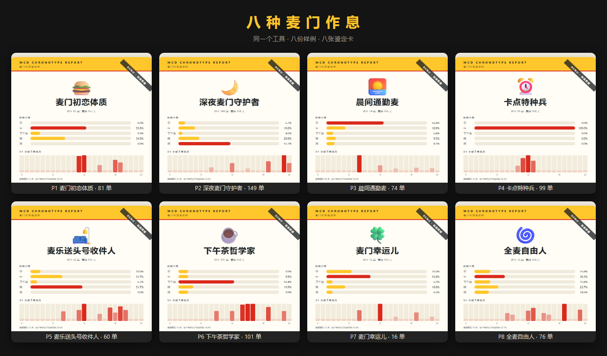
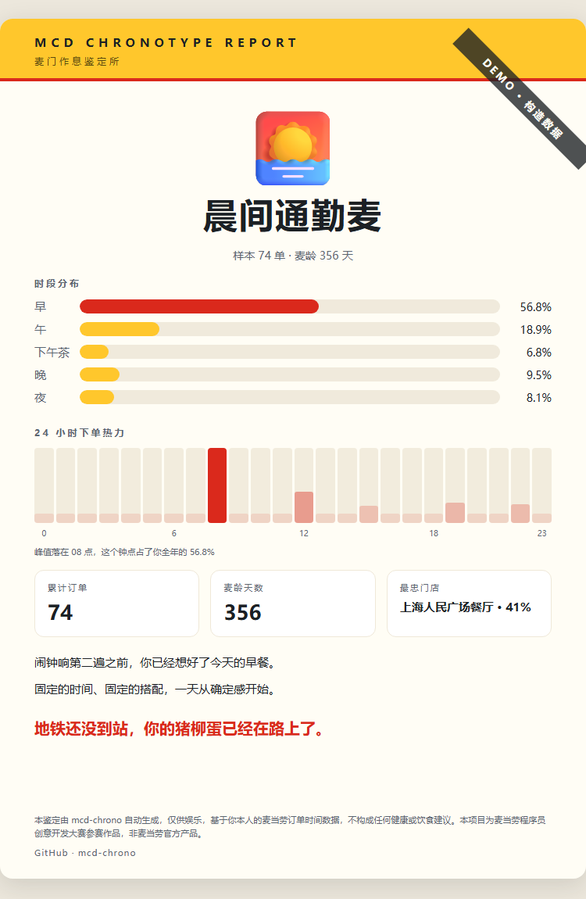
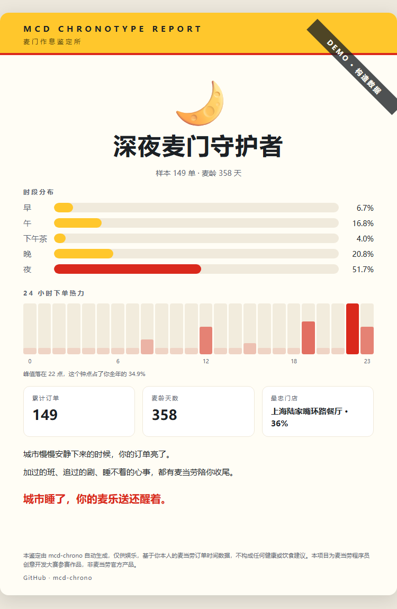
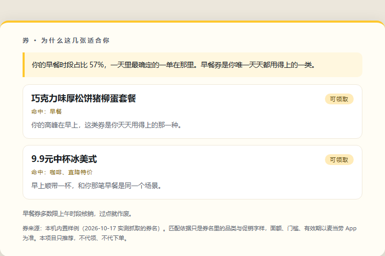

# 麦门作息鉴定 · mcd-chrono

把你一年在麦当劳的下单时间，鉴定成一种打工人作息人格。

**在线试玩** → <https://peterfeng1030-dot.github.io/mcd-chrono/>
六道题，二十秒出结果，不用装 Python，也不用申请 Token。



八种人格、八份样例，全部能用 `--demo` 离线复现——上面每张卡都是这个仓库真实跑出来的输出，
不是设计稿。

> 本仓库是麦当劳程序员创意开发大赛参赛作品。这个比赛只看一件事：仓库的 Star 数。
> 如果你觉得这东西有点意思，右上角那颗星就是它唯一的排名依据。

同样一份套餐，早上七点半吃和凌晨一点吃，说的是两种人生。mcd-chrono 调麦当劳官方 MCP
拉你自己的历史订单，只看一件事：你**什么时候**下的单。然后给出一张鉴定卡，一个称号，
一句判词。报告页里还会告诉你，那几张可领的券为什么适合你这种人。

一行命令，不需要 Token 也能先看效果。

```bash
python main.py --demo
```

## 为什么只看时间

麦当劳的 App 已经回答了"我吃了什么"。没人回答的是另一个问题：这一年的订单落在哪些钟点，
能不能看出你过的是什么日子。

早上七点十分出现在同一家店的人，和晚上十一点下单的人，工作性质、作息、甚至城市里的位置
都不一样。订单时间是这个城市里最容易被忽略、又最诚实的一类行为数据。

八种人格，规则全部公开，阈值写死在 `persona.py` 的 `THRESHOLDS` 里，改数字就能改松紧。

## 八种人格

| | 称号 | 判定条件 |
|---|---|---|
| 🍔 | 麦门初恋体质 | 单个品项金额占比 ≥ 40% |
| 🌙 | 深夜麦门守护者 | 夜间（21 点后，或凌晨 5 点前）订单占比 ≥ 25% |
| 🌅 | 晨间通勤麦 | 早餐时段占比 ≥ 35%，且时间离散 ≤ 45 分钟 |
| ⏰ | 卡点特种兵 | 工作日午市卡点率 ≥ 45%，且下单时刻离散 < 75 分钟 |
| 🛋️ | 麦乐送头号收件人 | 周末占比 ≥ 40%，且外送占比 ≥ 50% |
| ☕ | 下午茶哲学家 | 14 点到 17 点订单占比 ≥ 30% |
| 🍀 | 麦门幸运儿 | 月均下单 < 1.5 单 |
| 🌀 | 全麦自由人 | 以上都不满足（兜底） |

判定从上往下，命中即停。每份报告都会写明命中的是哪条线、实际数字是多少，不做黑箱。
样本不足 5 单的不进判定链，直接出 🍟 安慰卡。

同一条数据管道，两张卡的差别只在时间：

| 早上七点半下单的人 | 晚上十一点下单的人 |
|---|---|
|  |  |
| 🌅 **晨间通勤麦** · 夜间订单 8.1% | 🌙 **深夜麦门守护者** · 夜间订单 51.7% |

## 鉴定之后：哪张券适合你

人格不是标签，它是「你在什么场景会下单」的结论。既然知道了场景，就能反向挑券：
不是把能领的券全列一遍，而是告诉你**这几张为什么适合你这种人**。



上面这张是真实输出（`--demo` 跑出来的报告页节选）。三条线各司其职：

- **整块开头**说的是这个人为什么导向这类券——用的是他的真实数字，比如「早餐时段占比 57%」。
- **每张券**只写一句「它落在你的哪个偏好里」，命中的标签直接摊开给你看，不做黑箱。
- **底部**是这条线不能越的界：券的面额、门槛、有效期以麦当劳 App 为准。

三件事必须讲清楚：

1. **只查不领。** 全程只调 `available-coupons`（查可领券），不调 `auto-bind-coupons`（自动领取），
   更不碰下单和抽奖接口。`test_coupons.py` 里有一条源码断言守着这件事。
2. **不算能省多少钱。** 券接口只返回券名、图片、状态、标签四个字段，没有面额、没有门槛、
   没有有效期。所以这里的匹配依据**只能是券名里的品类与促销字样**，报告里也这么写。
   假装算得出省多少，就是编数据。
3. **卡片里没有券。** 分享图只回答「我是谁」，券只出现在报告页。混在一起，那张图就不干净了。

不想看券就加 `--no-coupons`。

## 快速开始

只需要 Python 3.10+，不装任何第三方包。

```bash
python main.py --demo                    # 默认出 p3 晨间通勤麦
python main.py --demo --sample p4        # 换成指定人格的样例
python main.py --demo --list-samples     # 看八份样例分别是哪种人格
python main.py --demo --share            # 顺便输出分享文案
python main.py --demo --no-coupons       # 只鉴定，不推荐券
```

`--sample` 收 `p1` 到 `p8`，与八个人格一一对应，八份样例都在 `fixtures/` 下。
旧名 `normal` / `heavy` 仍然可用，分别指向 `p3` 和 `p2`。

选券默认开着：`--demo` 用 `fixtures/demo_coupons.json`（2026-10-17 实测抓到的券名），
`--live` 用你自己账号当前可领的券。券取不到不影响鉴定，只是报告里少一块。

运行完在 `out/` 下得到三个文件：

| 文件 | 用途 |
|---|---|
| `chrono_card.html` | 只有卡片，直接截图发出去 |
| `chrono_report.html` | 完整报告，含判定依据明细与选券块 |
| `chrono_report.md` | 纯文本版 |

## 用你自己的真实数据

**第一步，申请 MCP Token。** 打开 [open.mcd.cn/mcp](https://open.mcd.cn/mcp)，手机号登录，
控制台点「激活」，复制 Token。免费，限流 600 次/分钟。

**第二步，验证并保存 Token。**

```bash
python scripts/check_token.py
```

Token 用不回显的方式输入，不会进命令行历史。验证通过后会写进项目根目录的 `.env`
（已在 `.gitignore` 里排除），之后不用每次设置环境变量。

**第三步，跑。**

```bash
python main.py --live
```

## 它输出什么

一张卡片上只有六样东西：称号、五时段分布、24 格逐小时热力条、三个数字、两行描述、一句判词。

热力条值得单说。它把一年几百笔订单压成 24 根柱子，柱子越高、颜色越深，表示那个钟点下单
越密集，末行直接告诉你峰值落在几点、占了全年多少。很多人第一次看到自己那张图会说
「原来我都在这个点吃」。

报告页里还有判定依据明细：样本量、区间、累计消费、命中依据、峰值时刻、最忠门店。
所有数字都可追溯，没有一句是编的。选券块也在报告页，卡片里没有。

## 用了哪些 MCP 工具

| 工具 | 用途 | 必需性 |
|---|---|---|
| `order-list` | 拉近一年历史订单（时间、类型、金额、门店） | 必需 |
| `query-order` | 逐笔补明细，算单品集中度 | 已接入，单笔失败自动降级 |
| `available-coupons` | 查当前可领的券，做人格匹配 | 仅 `--live`，失败自动跳过 |

`order-list` 定骨架，`query-order` 补细节。一年一百多单也就一百多次调用，离每分钟
600 次的限额很远。单笔明细拉不到时自动降级，不影响其余七条判定线。

**刻意没有接入的工具**：`auto-bind-coupons`（自动领券）、`create-order`（下单）、
`draw-lottery`（抽奖）、`mall-create-order`（商城兑换）。这个项目的边界是「告诉你怎么看自己」，
不是替你把钱花掉。

## 目标用户

- 想知道自己这一年到底在几点吃麦当劳的人
- 想给年度消费留一张能发出去的图的人
- 想看 MCP 工具链怎么被编排成一个小而完整的产品的开发者

## 项目结构

```
mcd-chrono/
├── main.py                    CLI 入口
├── mcp_client.py              MCP Streamable HTTP 客户端（urllib 实现）
├── fetch.py                   取数与字段容错
├── features.py                T1~T10 特征提取
├── persona.py                 八人格判定引擎与全部文案
├── coupons.py                 券匹配：券名 → 标签 → 人格偏好排序（只读）
├── card.py                    卡片 / 报告 / Markdown 渲染
├── fixtures/                  八份构造样例（p1→P1 … p8→P8）、券样例及其生成器
├── scripts/
│   ├── check_token.py         Token 验证与本地保存
│   └── build_wall.py          八人格墙生成器（README 首图的数据源）
├── docs/
│   ├── requirements/          需求文档
│   ├── design/                设计文档
│   ├── assets/                卡片示例图、八人格墙、选券块截图
│   └── batches/tests/         单元测试（91 例：判定链、特征、卡片离线渲染、样例归宿、券匹配）
└── out/                       输出目录（不提交）
```

## Roadmap

已经做完的是「鉴定 + 选券」：券只按券名里的品类与促销字样去对人格的时段偏好，
不算金额、不代领、不下单——因为券接口给不出面额和门槛，而编一个出来就等于骗人。

再往前一步想做的事情，都需要更硬的数据支撑，所以先写在这里不当成承诺：

- **券的可用性校验。** 现在不知道一张券能不能用在你常去的那家店、那个时段。
  真要做，得走 `query-store-coupons`（门槛 `<storeCode, orderType>`），
  还要先拿到定位与门店编码，成本比现在这套高一个量级。
- **算清一张券值多少。** 需要 `query-meals` 的餐品价格配 `calculate-price` 逐单试算，
  才知道「这张券对这个人到底省几块」。这已经不是文案问题，是计算问题。
- **把年份做成时间轴。** 现在只有一张卡，一年里的转折点（比如某个季度突然开始点夜宵）
  还没被讲出来。

## 免责声明

本项目为麦当劳程序员创意开发大赛参赛作品，由参赛者独立开发，**非麦当劳官方产品**，
未获麦当劳授权或认可。鉴定结果基于你自己的历史订单时间，仅供娱乐与回顾，不构成营养、
医疗或其他专业建议。券信息以麦当劳 App 实时结果为准，本项目只做展示与匹配，
不代领、不代下单、不参与任何交易。

---

## Quick Start (English)

mcd-chrono reads your McDonald's China order history through the official MCP server and
turns **when** you order into a working-person chronotype: a title, a distribution chart,
a 24-hour heat strip, and one verdict line.

Standard library only. No `pip install` needed.

```bash
python main.py --demo                    # built-in samples, no token required
python main.py --demo --sample p4        # eight sample profiles, one per persona
```

For your own data, get a free MCP token at [open.mcd.cn/mcp](https://open.mcd.cn/mcp), then:

```bash
python scripts/check_token.py            # verify and store the token locally
python main.py --live                    # run on your real order history
```

The report page also matches your chronotype against the coupons you can currently claim
(`available-coupons`) and explains **why** each one fits your ordering window. It is
read-only: this project never claims a coupon, never places an order, and never estimates
savings it cannot verify. Pass `--no-coupons` to turn the block off.
```

Eight personas, all rules public in `persona.py`.

This is an entry for the McDonald's Developer Innovation Challenge. Not an official
McDonald's product. If you find it interesting, a star helps it rank.
